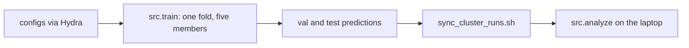

# The Value of a Second Modality: Epistemic Uncertainty in Multimodal Skin Lesion Classification

ADLM practical, WiSe 2026/27, TUM AIM. Team: Larissa Manalil, Yannic Neu, Emre Kalkan.
Supervisor: Raphael. Does clinical metadata reduce an image classifier's epistemic uncertainty?
Per test image, dEU = EU(image) - EU(image + metadata), on PAD-UFES-20.

This repo trains the ensembles and writes the comparison report under
`outputs/result-analysis/`. Exploratory analysis of the dataset lives in
[eda](https://github.com/ADLM-Multimodal-Uncertainty/eda). Course slides and the written
report live in
[reports-and-presentations](https://github.com/ADLM-Multimodal-Uncertainty/reports-and-presentations).

## Setup

On a laptop:

```bash
uv sync --extra dev
uv run pytest
```

On the cluster, package installation is the CPU job `scripts/slurm/sync_env.sbatch`.
See [Cluster](#cluster).

Download PAD-UFES-20 from [Mendeley Data](https://data.mendeley.com/datasets/zr7vgbcyr2) into
`data/pad_ufes_20/`:

```
data/pad_ufes_20/metadata.csv
data/pad_ufes_20/images/...        # flat or imgs_part_*/, searched recursively
```

The committed file `data/splits/pad_ufes20_5fold_patient.csv` is the patient-grouped
five-fold assignment. The default experiment uses `split.n_folds=2`, which generates a
patient-grouped split (`split.seed=42`) and leaves that CSV unused. Setting `n_folds=5`
with `csv=null` reads the committed file.

## Baseline

Image-only and image-plus-metadata share one recipe, selected by `experiment=baseline_image_only`
or `experiment=baseline_multimodal`. The image-only preset drops the metadata MLP.

| Piece | Setting |
| --- | --- |
| Split | Two patient-disjoint folds. Test is one fold. Validation is 20% of the other fold's patients. |
| Model | ImageNet ResNet18, fine-tuned (`freeze=false`), projection 512 to 128. Metadata MLP hidden size 64, concatenated into a 128-unit head. |
| Ensemble | Five members, seeds 0–4, same split for every member. |
| Loss | Inverse-frequency class weights (`class_weight_power=1`), rescaled to mean 1. |
| Optimization | AdamW, learning rate `1e-4`, weight decay `0.01`. ReduceLROnPlateau on `val_loss`, factor 0.5, patience 3, minimum learning rate `1e-6`. |
| Stopping | At most 30 epochs. Stop when `val_loss` has not improved for 8 epochs. |
| Augmentation | Training only: resize to 224, horizontal and vertical flips at probability 0.5, rotation of ±15° with reflect padding and a center crop. Validation and test are a deterministic resize plus ImageNet normalization. |

```bash
scripts/local/smoke.sh experiment=baseline_multimodal
uv run python -m src.train experiment=baseline_multimodal --cfg job
scripts/local/run.sh -m experiment=baseline_image_only
scripts/local/run.sh -m experiment=baseline_multimodal
```

The smoke run writes one epoch under `outputs/smoke` and skips the five-member ensemble.
`--cfg job` prints the composed configuration. `-m` trains every fold. Without it, only
`fold=0` runs. A fold directory is

```
outputs/runs/<run_group>/fold_<k>/
  config.yaml
  test_metrics.json
  test_predictions.csv
  test_member_predictions.npz
  val_metrics.json
  val_predictions.csv
  val_member_predictions.npz
  members/seed_<s>/          # history.csv, best.pt, curves.png, ...
```

Uncertainty columns are total, aleatoric, and epistemic entropy in nats. Re-score a saved
fold with `uv run python -m src.evaluate <fold_dir>`. Redraw member curves with
`uv run python -m src.visualize <fold_dir>`.

## Reports

`uv run python -m src.analyze` runs on the laptop. It reads
`{val,test}_member_predictions.npz` and each member's `history.csv`.

`eval_split=val` is the split used while choosing a hyperparameter. `eval_split=test` is
the final report, and it is the only mode that updates `outputs/result-analysis/summary/`.
One `experiment_id` is one directory, so a later run with the same id replaces `REPORT.md`
and the figures. Keep the validation report and the test report under different ids when
both should remain.

A single comparison sets `reference` and `candidate`. A recipe comparison sets
`baseline_image`, `baseline_multimodal`, `candidate_image`, `candidate_multimodal`, and
`candidate_label`. The command uses one of those two forms.

```bash
uv run python -m src.analyze \
  experiment_id=default_baseline eval_split=val \
  reference=baseline_image_only candidate=baseline_multimodal

uv run python -m src.analyze \
  experiment_id=default_baseline_test eval_split=test \
  reference=baseline_image_only candidate=baseline_multimodal
```

To compare a candidate recipe with the baseline, train both setups for each recipe, then:

```bash
uv run python -m src.analyze \
  experiment_id=crop_zoom_vs_baseline eval_split=val \
  baseline_image=baseline_image_only \
  baseline_multimodal=baseline_multimodal \
  candidate_image=crop_zoom_image_only \
  candidate_multimodal=crop_zoom_multimodal \
  candidate_label="Crop and zoom"
```

Each run writes `manifest.yaml`, `REPORT.md`, CSVs under `tables/` and `data/`, and figures
under `figures/`. `REPORT.md` prints one pair of narrow tables per comparison: classification
change as candidate minus reference, in percentage points, then total, aleatoric, and
epistemic uncertainty as reference minus candidate, in nats. The wide columns stay in
`tables/paired_effects.csv`. A recipe comparison also writes
`tables/setting_uncertainty_change.csv` and `figures/setting_uncertainty_change.png`:
dAU, dEU, and dTU are the baseline setting minus the candidate setting for image-only
and for image + metadata, and d(dEU) is how the metadata EU reduction changes between
those settings.

Per-comparison figures append the comparison id (`primary` for the single report;
`baseline_modality`, `candidate_modality`, `image_only_change`, and `multimodal_change` for
a recipe report):

- `paired_eu_scatter_<id>.png`
- `paired_deu_distribution_<id>.png` — both correct, fixed, broken, both wrong
- `paired_deu_candles_<id>.png` — the same four groups as quartile boxes, with the mean marked

Confusion matrices, paired-effect estimates, and validation curves are shared across the
comparisons in that report. Metric definitions are in
[docs/implementation_spec.md](docs/implementation_spec.md).

## Tuning without overwriting a run

Experiment presets set `name` (`baseline_image_only`, `baseline_multimodal`). A single Hydra
run, including every `sbatch`, writes `outputs/runs/<name>/`. Set `name=` on every changed
recipe.

`scripts/local/run.sh -m` is a Hydra multirun. Overrides that change the trained model are
appended to the directory name. Fold, device, data path, subset, and image size stay out of
that suffix. Pass `tag=...` to choose the suffix yourself.

```bash
# Augmentation presets: none, flips, baseline, crop_zoom, mild_color, combined
scripts/local/run.sh -m experiment=baseline_multimodal \
  data/augmentation=crop_zoom name=crop_zoom_multimodal

# Learning rate and scheduler: plateau, cosine, step, none
scripts/local/run.sh -m experiment=baseline_image_only \
  train.optimizer.lr=3e-4 train/scheduler=cosine name=cosine_3e-4_image_only

# Class-weight power. 0 is unweighted, 0.5 is square-root tempered, 1 is inverse frequency.
scripts/local/run.sh -m experiment=baseline_multimodal \
  train.class_weight_power=0.5 name=power_0.5_multimodal
```

The same `name=` is required on the cluster, where each submission is one Hydra run and the
array already covers the two folds:

```bash
sbatch scripts/slurm/fold_ensemble_array.sbatch \
  experiment=baseline_image_only train.class_weight_power=0.5 name=power_0.5_image_only
sbatch scripts/slurm/fold_ensemble_array.sbatch \
  experiment=baseline_multimodal train.class_weight_power=0.5 name=power_0.5_multimodal
```

Compare recipes on the validation split. `val_nll` and `val_brier` in `history.csv` are
unweighted, so they stay comparable when the class-weight power changes. `val_loss` is the
weighted training objective and is the early-stopping signal.

## Cluster

Full rules are in [docs/cluster_guide.md](docs/cluster_guide.md). The run path is:

1. On the laptop, commit and push. On selene, `git pull` the same commit. Selene is for
   `git pull`, `sbatch`, `squeue`, `sacct`, `scancel`, and reading logs.
2. Install or refresh packages with `sbatch scripts/slurm/sync_env.sbatch`. That job is CPU
   only, uses `master-queuesave`, and counts toward the two-job cap.
3. Train on a GPU. `fold_ensemble_array.sbatch` already sets `--array=0-1%1`, one GPU, and
   `master-queuesave`. One task trains one fold, all five members, then writes validation and
   test predictions. The two commands below are the two jobs the QoS allows:

```bash
sbatch scripts/slurm/fold_ensemble_array.sbatch experiment=baseline_image_only
sbatch scripts/slurm/fold_ensemble_array.sbatch experiment=baseline_multimodal
```

4. Copy the finished run groups back. The copy includes predictions, histories, and
   `config.yaml`. Weight files stay on the cluster unless `INCLUDE_CHECKPOINTS=1`. Set
   `CLUSTER_USER` to the CIT account when it differs from the local username:

```bash
CLUSTER_USER=<cit-username> scripts/local/sync_cluster_runs.sh \
  baseline_image_only baseline_multimodal
```

5. Build the report on the laptop with `uv run python -m src.analyze`, as in
   [Reports](#reports). Analysis reads the copied predictions and is part of the laptop step.

## How a run is assembled

Hydra is required. Choices live in `configs/`, and `tests/test_configs.py` checks every YAML
against its `_target_`. Read [AGENTS.md](AGENTS.md) and
[docs/design_decisions.md](docs/design_decisions.md) before adding an experiment.



A local `run.sh` already writes `outputs/runs/`, so the copy step applies to cluster jobs.
The report step is the same in both cases.

## Layout

```
configs/          data, augmentation, split, model, train, scheduler, ensemble, experiment, analyze.yaml
src/              data, models, train, evaluate, metrics, uq, visualize, analysis
scripts/local/    run.sh, smoke.sh, sync_cluster_runs.sh
scripts/slurm/    fold_ensemble_array.sbatch, train.sbatch, smoke_test.sbatch, sync_env.sbatch
docs/             implementation_spec.md, cluster_guide.md, design_decisions.md
```

## Conventions

- Splits are grouped by `patient_id`. Augmentation is applied only after that split, and only
  to the training images.
- Images whose clinical block is missing stay in the cohort. Numeric fields use the training
  median, and categorical fields use a `Missing` category. `biopsed` and the ID columns are
  excluded from the features.
- Develop every new feature on a dedicated branch. Do not commit directly to `main`.
- Data, outputs, and checkpoints stay out of the repo. On the cluster, code and outputs live
  under `/vol/miltank`, and caches live under `/meta`.
