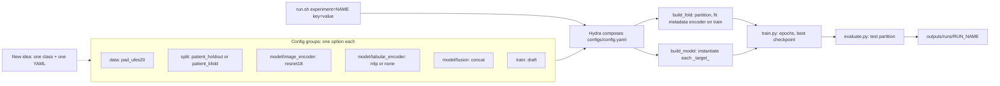
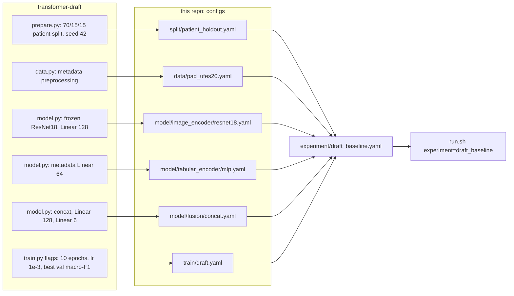

# The Value of a Second Modality: Epistemic Uncertainty in Multimodal Skin Lesion Classification

ADLM practical, WiSe 2026/27, TUM AIM. Team: Larissa Manalil, Yannic Neu, Emre Kalkan.
Supervisor: Raphael. Does clinical metadata reduce an image classifier's epistemic uncertainty?
Per test image, dEU = EU(image) - EU(image + metadata), on PAD-UFES-20.

This repo only runs the GPU experiments. Data analysis lives in
[eda](https://github.com/ADLM-Multimodal-Uncertainty/eda); slides, report and figures in
[reports-and-presentations](https://github.com/ADLM-Multimodal-Uncertainty/reports-and-presentations).

## Setup

```bash
uv sync --extra dev
uv run pytest                      # synthetic data, no download needed
```

Download PAD-UFES-20 from [Mendeley Data](https://data.mendeley.com/datasets/zr7vgbcyr2) into
`data/pad_ufes_20/` (the same layout as the draft repo, so one folder serves both; or pass
`data.root=...`):

```
data/pad_ufes_20/metadata.csv
data/pad_ufes_20/images/...        # flat or imgs_part_*/, searched recursively
```

Only the patient-grouped fold assignment in `data/splits/` is committed.

## Local runs

```bash
scripts/local/smoke.sh experiment=draft_baseline
scripts/local/run.sh experiment=draft_baseline
scripts/local/run.sh experiment=draft_image_only
scripts/local/run.sh experiment=draft_baseline split=patient_kfold fold=2 name=kfold_f2
uv run python -m src.train experiment=draft_baseline --cfg job
```

In order: a one-minute pipeline check (64 images, one epoch, no weight download); the draft's
multimodal and image-only modes; the same model on the committed 5-fold split; printing the
composed config without running. Arguments after the script are Hydra overrides (`key=value`,
no `--flags`).

Each run trains, keeps the best epoch by `train.monitor`, evaluates it once on the test
partition and writes `config.yaml`, `history.csv`, `best.pt`, `test_metrics.json` and
`test_predictions.csv` to `outputs/runs/<run_name>/`. Re-evaluate with
`uv run python -m src.evaluate outputs/runs/<run_name>`.

## How it works

A run is one choice per config group. Hydra composes them, each `_target_` names the class to
build, and the pipeline code stays the same for every experiment:



To add an option (a new fusion, encoder, split, ...), write the class following the contract in
its module docstring and add `configs/<group>/<name>.yaml` with `_target_` and its
hyperparameters; select it with `<group>=<name>`. `tests/test_configs.py` checks every YAML
against its class signature. When overriding a single field on the CLI, also pass `name=...`
so the run gets its own directory.

## Example: the draft repo as an experiment

[transformer-draft](https://github.com/ADLM-Multimodal-Uncertainty/transformer-draft) is one
script with command-line flags. Here each of its parts became one config option, and an
experiment file picks them:



The whole experiment file, `configs/experiment/draft_baseline.yaml`:

```yaml
# @package _global_
defaults:
  - override /split: patient_holdout
  - override /model/image_encoder: resnet18
  - override /model/tabular_encoder: mlp
  - override /model/fusion: concat
  - override /train: draft

name: draft_baseline
```

`draft_image_only.yaml` is the same with `override /model/tabular_encoder: null`. Both reproduce
the draft exactly: on the real data the two repos give the same split, the same loss and
validation macro-F1 at every epoch, and identical test predictions (seed 42).

A new experiment is another small file in `configs/experiment/`, for example k-fold with a
fine-tuned backbone and class-weighted loss:

```yaml
# @package _global_
defaults:
  - override /split: patient_kfold

name: draft_kfold_finetune
fold: 0
model:
  image_encoder:
    freeze: false
train:
  weighted_loss: true
  optimizer:
    lr: 1.0e-4
```

Cluster: `docs/cluster_guide.md` and `scripts/slurm/` (not yet wired to these configs).

## Layout

```
configs/          one folder per swappable part: data, split, model/{image_encoder,
                  tabular_encoder,fusion}, train, uq, ensemble, experiment
src/              data/, models/, uq/, train.py, evaluate.py, metrics.py
scripts/local/    run.sh, smoke.sh
scripts/slurm/    smoke_test, train, ensemble_array
data/splits/      committed fold assignment
tests/
docs/             cluster guide
```

## Conventions

- Splits are grouped by `patient_id`; `lesion_id` is only unique within a patient.
- The 804 images with the clinical block missing are all non-biopsied ACK/SEK/NEV; report
  results with and without missingness indicators and on complete rows only.
- Commit before every run (hash into W&B and Notion). Data, outputs and checkpoints live on
  `/vol/miltank`, never in the repo.
- One branch per feature, PR + one review into `main`, CI green.
