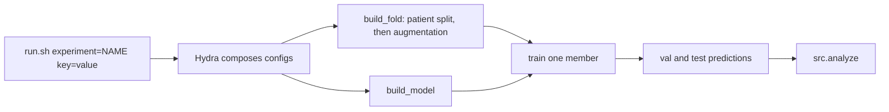

# The Value of a Second Modality: Epistemic Uncertainty in Multimodal Skin Lesion Classification

ADLM practical, WiSe 2026/27, TUM AIM. Team: Larissa Manalil, Yannic Neu, Emre Kalkan.
Supervisor: Raphael. Does clinical metadata reduce an image classifier's epistemic uncertainty?
Per test image, dEU = EU(image) - EU(image + metadata), on PAD-UFES-20.

This repo only runs the experiments. Data analysis lives in
[eda](https://github.com/ADLM-Multimodal-Uncertainty/eda); slides, report and figures in
[reports-and-presentations](https://github.com/ADLM-Multimodal-Uncertainty/reports-and-presentations).

## Setup

```bash
uv sync --extra dev
uv run pytest
```

Download PAD-UFES-20 from [Mendeley Data](https://data.mendeley.com/datasets/zr7vgbcyr2) into
`data/pad_ufes_20/`:

```
data/pad_ufes_20/metadata.csv
data/pad_ufes_20/images/...        # flat or imgs_part_*/, searched recursively
```

Only the patient-grouped five-fold assignment in `data/splits/` is committed. The default
experiment generates a two-fold patient split instead of using that file.

## Baseline

Image-only and image-plus-metadata share one recipe, selected by `experiment=baseline_image_only`
or `experiment=baseline_multimodal`:

| Piece | Setting |
| --- | --- |
| Split | Two patient-disjoint folds. Test is one fold; validation is 20% of the other fold's patients. |
| Model | ImageNet ResNet18, fine-tuned, projection 512 to 128. Metadata MLP only in the multimodal run. |
| Ensemble | Five members, seeds 0–4, same split for every member. |
| Loss | Inverse-frequency class weights (`class_weight_power=1`), rescaled to mean 1. |
| Optimization | AdamW, learning rate `1e-4`, weight decay `0.01`, ReduceLROnPlateau. |
| Stopping | At most 30 epochs; stop when `val_loss` has not improved for 8 epochs. |
| Augmentation | Training only: horizontal flip, vertical flip, and rotation of 15 degrees. |

```bash
scripts/local/smoke.sh experiment=baseline_multimodal
uv run python -m src.train experiment=baseline_multimodal --cfg job
scripts/local/run.sh -m experiment=baseline_image_only
scripts/local/run.sh -m experiment=baseline_multimodal
```

`-m` trains every fold. Without it, only `fold=0` runs. A fold directory is

```
outputs/runs/<run_group>/fold_<k>/
  config.yaml
  test_metrics.json
  test_predictions.csv
  test_member_predictions.npz
  val_metrics.json
  val_predictions.csv
  val_member_predictions.npz
  members/seed_<s>/          # history.csv, best.pt, curves.png, ...
```

The same files exist for validation, so a hyperparameter comparison can use `eval_split=val`
and leave the test folds for the final report. Uncertainty columns are total, aleatoric, and
epistemic entropy in nats. Re-evaluate with `uv run python -m src.evaluate <fold_dir>`.
Redraw member curves with `uv run python -m src.visualize <fold_dir>`.

## Reports

After both folds of a pair are available:

```bash
uv run python -m src.analyze \
  experiment_id=default_baseline eval_split=test \
  reference=baseline_image_only candidate=baseline_multimodal
```

To compare a candidate recipe with the baseline, train both setups for each recipe, then:

```bash
uv run python -m src.analyze \
  experiment_id=crop_zoom_vs_baseline eval_split=val \
  baseline_image=baseline_image_only \
  baseline_multimodal=baseline_multimodal \
  candidate_image=crop_zoom_image_only \
  candidate_multimodal=crop_zoom_multimodal \
  candidate_label="Crop and zoom"
```

Tables, figures, `manifest.yaml`, and `REPORT.md` are written to
`outputs/result-analysis/<experiment_id>/`. A test-split report also updates
`outputs/result-analysis/summary/`. Metric definitions are in
[docs/implementation_spec.md](docs/implementation_spec.md).

## Tuning without overwriting a run

Give a changed recipe its own `name`. A Hydra multirun that changes a hyperparameter also
adds that override to the directory name, so two learning rates do not share a folder.
Pass `tag=...` to choose the suffix yourself.

```bash
# Augmentation presets: none, flips, baseline, crop_zoom, mild_color, combined
scripts/local/run.sh -m experiment=baseline_multimodal \
  data/augmentation=crop_zoom name=crop_zoom_multimodal

# Learning rate and scheduler: plateau, cosine, step, none
scripts/local/run.sh -m experiment=baseline_image_only \
  train.optimizer.lr=3e-4 train/scheduler=cosine name=cosine_3e-4_image_only

# Class-weight power. 0 is unweighted, 0.5 is square-root tempered, 1 is inverse frequency.
scripts/local/run.sh -m experiment=baseline_multimodal \
  train.class_weight_power=0.5 name=power_0.5_multimodal
```

Compare recipes on the validation split. `val_nll` and `val_brier` in `history.csv` are
unweighted, so they stay comparable when the class-weight power changes. `val_loss` is the
weighted training objective and is only the early-stopping signal.

## Cluster

See [docs/cluster_guide.md](docs/cluster_guide.md). One array task trains one fold:

```bash
sbatch scripts/slurm/fold_ensemble_array.sbatch experiment=baseline_image_only
sbatch scripts/slurm/fold_ensemble_array.sbatch experiment=baseline_multimodal
```

Copy the predictions back without the checkpoints:

```bash
scripts/local/sync_cluster_runs.sh baseline_image_only baseline_multimodal
```

## How a run is assembled

Hydra is required. Choices live in `configs/`, and `tests/test_configs.py` checks every YAML
against its `_target_`. Read [AGENTS.md](AGENTS.md) and
[docs/design_decisions.md](docs/design_decisions.md) before adding an experiment.



## Layout

```
configs/          data, augmentation, split, model, train, scheduler, ensemble, experiment
src/              data, models, train, evaluate, metrics, visualize, analyze
scripts/local/    run.sh, smoke.sh, sync_cluster_runs.sh
scripts/slurm/    fold_ensemble_array.sbatch, train.sbatch, smoke_test.sbatch
```

## Conventions

- Splits are grouped by `patient_id`. Augmentation is applied only after that split, and only
  to the training images.
- The 804 images with the clinical block missing are all non-biopsied ACK/SEK/NEV; report
  results with and without missingness indicators and on complete rows only.
- Develop every new feature on a dedicated branch. Do not commit directly to `main`.
- Data, outputs, and checkpoints stay out of the repo. On the cluster they live under
  `/vol/miltank`.
