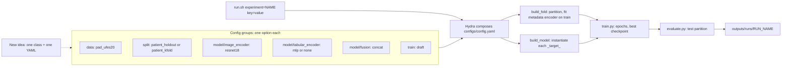
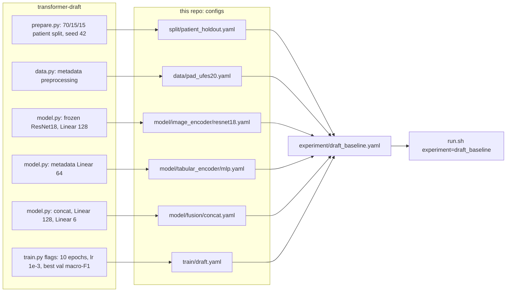

# The Value of a Second Modality: Epistemic Uncertainty in Multimodal Skin Lesion Classification

ADLM practical, WiSe 2026/27, TUM AIM. Team: Larissa Manalil, Yannic Neu, Emre Kalkan.
Supervisor: Raphael. Does clinical metadata reduce an image classifier's epistemic uncertainty?
Per test image, dEU = EU(image) - EU(image + metadata), on PAD-UFES-20.

This repo only runs the experiments. Data analysis lives in  
[eda](https://github.com/ADLM-Multimodal-Uncertainty/eda); slides, report and figures in
[reports-and-presentations](https://github.com/ADLM-Multimodal-Uncertainty/reports-and-presentations).

## Setup

```bash
uv sync --extra dev
uv run pytest                      # synthetic data, no download needed
```

Download PAD-UFES-20 from [Mendeley Data](https://data.mendeley.com/datasets/zr7vgbcyr2) into
`data/pad_ufes_20/` (the same layout as the draft repo, so one folder serves both; or pass
`data.root=...`):

```
data/pad_ufes_20/metadata.csv
data/pad_ufes_20/images/...        # flat or imgs_part_*/, searched recursively
```

Only the patient-grouped fold assignment in `data/splits/` is committed.

## Local runs

```bash
scripts/local/smoke.sh experiment=draft_baseline
scripts/local/run.sh experiment=draft_baseline
scripts/local/run.sh experiment=draft_image_only
scripts/local/run.sh experiment=draft_baseline split=patient_kfold fold=1 name=kfold_f1
uv run python -m src.train experiment=draft_baseline --cfg job
```

In order: a one-minute pipeline check (64 images, one epoch, no weight download); the draft's
multimodal and image-only modes; the same model on the default 2-fold patient split; printing the
composed config without running. Arguments after the script are Hydra overrides (`key=value`,
no `--flags`).

Each run trains, keeps the best epoch by `train.monitor`, evaluates it once on the test
partition and writes `config.yaml`, `history.csv`, `best.pt`, `test_metrics.json`,
`test_predictions.csv`, `curves.png` and `confusion_matrix.png` to `outputs/runs/<run_name>/`.

Overfitting check: `history.csv` and `curves.png` hold loss, accuracy, balanced accuracy and
macro-F1 for both the training set (scored in eval mode, dropout off) and the validation set,
per epoch. Overfitting shows as validation loss turning upward while training loss keeps
falling, or a widening gap between the dashed (train) and solid (validation) lines. The
validation set is small (354 images, 6 MEL), so single-epoch dips are noise. The training-set
pass costs one extra forward pass per epoch; turn it off with `train.track_train_metrics=false`
(the train columns are then omitted). Re-evaluate with
`uv run python -m src.evaluate outputs/runs/<run_name>`; redraw the plots with
`uv run python -m src.visualize outputs/runs/<run_name>`.

## Patient cross-validation

Patient k-fold splitting defaults to **two folds** (`split.n_folds=2`).
To use the committed five-fold assignment, select five folds explicitly:

```bash
scripts/local/run.sh -m experiment=patient_5fold_multimodal split.n_folds=5 name=patient_5fold_multimodal
scripts/local/run.sh -m experiment=patient_5fold_image_only split.n_folds=5 name=patient_5fold_image_only
```

Each preset sets the Hydra fold sweep to `range(0,${split.n_folds})`; `-m` launches all configured
folds (five in the examples above). Without `-m`, it trains only `fold=0` (or the selected `fold`). To run a specific fold:

```bash
scripts/local/run.sh experiment=patient_5fold_multimodal split.n_folds=5 fold=2
```

Test is fold `k`, validation is `(k + 1) % 5`, and training uses the other three folds:
roughly **60/20/20**, with sizes varying by images per patient. Each patient is tested once
across the five runs. This preserves the repository's rotating validation protocol, rather
than training on all four non-test folds. Validation selects the checkpoint; metadata
preprocessing fits only training rows. The CSV is shared by both modalities, independent of
training seed. Assignments are validated for patient consistency, complete fold IDs and
coverage of the supplied metadata before training.

Each fold writes its own resolved configuration, checkpoint and test metrics under
`outputs/runs/patient_5fold_<mode>-patient_kfold-f<fold>-s<seed>/`. These are cross-validation
models, not deep ensemble members; compare their per-fold scores and report mean and spread.
Automatic score aggregation is not implemented. `-m seed=0,1,2` also repeats every fold for
three training seeds. Set `name=...` when changing other settings to keep outputs distinct.
The draft holdout experiments remain available unchanged.

The fold count is configurable. For example, run two folds with either preset:

```bash
scripts/local/run.sh -m experiment=patient_5fold_multimodal split.n_folds=2 name=patient_2fold_multimodal
scripts/local/run.sh -m experiment=patient_5fold_image_only split.n_folds=2 name=patient_2fold_image_only
```

The preset names retain `5fold` for compatibility; the sweep follows `split.n_folds`.
With `split.csv=null` (default), five folds reuse the committed assignment and other
counts generate deterministic patient-grouped folds from metadata. An explicit
`split.csv=...` must match the configured fold count. Generated folds are grouped,
not class-stratified. For two folds, half the patients are tested and the other half
are split into training/validation with `split.val_size=0.2` and `split.seed=42`
(approximately 40/10/50 overall). Three or more folds retain rotating validation.
Use the same metadata and split settings for paired modality comparisons.

## Deep ensembles

Train independent members on the same patient split through the common pipeline:

```bash
scripts/local/run.sh experiment=deep_ensemble
scripts/local/run.sh experiment=deep_ensemble_image_only
scripts/local/run.sh experiment=deep_ensemble ensemble.seeds=[0,1,2] name=ensemble_three
uv run python -m src.evaluate outputs/runs/deep_ensemble-patient_holdout-f0-s42
```

`ensemble=deep` can also be combined with other experiments; give the combination a distinct
`name`. `ensemble.seeds` sets the member training seeds (at least two distinct integers).
The top-level `seed` remains part of the run name; split membership comes from the saved
`split` configuration and `fold`, shared by all members. Five seeds are the default.
Members train sequentially and select their own best validation checkpoint. This is an
ensemble of independently trained models, without bootstrap resampling.

The ensemble directory contains the resolved `config.yaml`, `members/seed_<seed>/` with
all ordinary training artifacts, `test_metrics.json` for the averaged probabilities, and
`test_predictions.csv` with mean class probabilities and three uncertainty columns:
`total_uncertainty` (entropy of the mean), `aleatoric_uncertainty` (mean member entropy),
and `epistemic_uncertainty` (their difference / mutual information). Entropies use natural
logarithms (nats). `test_member_predictions.npz` stores `probabilities` with shape
(member, image, class), plus `seeds`, `img_ids`, `patient_ids`, `labels` (class indices), and
`classes`, so outputs can be joined by image ID for later image-only/multimodal comparisons.
Load it with `numpy.load(path, allow_pickle=False)`. Re-evaluation uses each member's saved
config and checkpoint and regenerates the aggregate artifacts; it requires the original data.
Training curves and confusion matrix plots remain in each member directory.

## Paired EU experiments

The `eu_v2_r18_*` presets are the calibrated ResNet18 setup (`train=eu_v2`: `monitor=val_loss`,
`early_stopping_patience=8`, `epochs=25`, `AdamW(lr=1e-4, weight_decay=0.01)`,
`ReduceLROnPlateau(mode=min, factor=0.5, patience=3, min_lr=1e-6)`, `data.augmentation=derm`,
full backbone fine-tuning, five ensemble seeds `[0, 1, 2, 3, 4]`, committed 5-fold patient split):

```bash
scripts/local/run.sh -m experiment=eu_v2_r18_image_only
scripts/local/run.sh -m experiment=eu_v2_r18_multimodal
scripts/local/run.sh -m experiment=eu_v2_r18_permuted_multimodal   # negative control
```

The earlier v1 `eu_baseline_r18_*` and `eu_resnet50_*` presets (`monitor=val_macro_f1`,
`data.augmentation=flip`, 10 epochs) remain unchanged for comparison:

```bash
scripts/local/run.sh -m experiment=eu_baseline_r18_image_only
scripts/local/run.sh -m experiment=eu_baseline_r18_multimodal
```

Screen ResNet50 on two of the same five rotations:

```bash
scripts/local/run.sh -m experiment=eu_resnet50_image_only fold=0,1
scripts/local/run.sh -m experiment=eu_resnet50_multimodal fold=0,1
```

The training-size positive control selects nested, diagnosis-stratified subsets of training
patients while leaving validation and test unchanged. Always change `name` so fractions do not
overwrite the full-data runs:

```bash
scripts/local/run.sh -m experiment=eu_baseline_r18_image_only fold=0,1 \
  data.train_fraction=0.25 name=eu_size_r18_f025_image_only
scripts/local/run.sh -m experiment=eu_baseline_r18_multimodal fold=0,1 \
  data.train_fraction=0.25 name=eu_size_r18_f025_multimodal
```

Use `0.5` for the half-data condition and reuse the matching full-data artifacts. The supported
fractions are `0.25`, `0.5`, and `1.0`; `data.train_subset_seed` controls the nested patient
assignment.

Paired analysis can either auto-discover all completed paired runs under a `runs/` folder or
consume an explicit JSON manifest:

```bash
# Auto-discover all completed paired ensembles under outputs/runs:
uv run python -m src.analyze \
  analysis.runs_root=outputs/runs \
  analysis.output_dir=outputs/analysis/paired

# Or use an explicit manifest:
uv run python -m src.analyze \
  analysis.manifest=outputs/analysis/manifest.json \
  analysis.output_dir=outputs/analysis/paired
```

Analysis verifies full pairing compatibility and writes:
- Per condition (`outputs/analysis/paired/<condition>/`): `per_image.csv`, `per_patient.csv`,
  `uncertainty_summary.csv`, `per_fold_summary.csv`, `training_curves.csv`,
  `error_detection_summary.csv`, `risk_coverage.csv`, `aurc_summary.csv`,
  `ensemble_size_stability.csv`, `missing_metadata_summary.csv`, `classification_metrics.json`,
  and plots (`loss_accuracy_curves.png`, `uncertainty.png`, `paired_eu_scatter.png`,
  `correct_vs_incorrect_eu.png`, `risk_coverage.png`, `classification.png`, `calibration.png`,
  `fold_comparison.png`, `ensemble_size_stability.png`, `missing_metadata_stratification.png`).
- Across all conditions (`outputs/analysis/paired/`): `condition_comparison.csv/json`,
  `all_folds_comparison.csv`, `eu_measures_agreement.csv`, `positive_control_summary.csv`,
  `summary_tables.md`, and cross-setup plots (`condition_comparison.png`,
  `eu_measures_comparison.png`, `cross_setup_fold_eu.png`, `cross_setup_learning_curves.png`,
  `train_fraction.png`).

For TUM chair cluster execution, see `docs/cluster_guide.md` and `scripts/slurm/`.

## Freeze or fine-tune ResNet18

Toggle `model.image_encoder.freeze` in any experiment. The default is `false`:
the entire ImageNet-pretrained ResNet18 is fine-tuned on our training patients,
including BatchNorm statistics. Set it to `true` to train only the projection,
metadata encoder (when present), and classifier. Keep `pretrained=true` to
start from ImageNet weights.

```bash
# Fine-tune the backbone with two patient folds.
scripts/local/run.sh -m experiment=patient_5fold_multimodal split.n_folds=2 model.image_encoder.freeze=false train.optimizer.lr=1e-4 name=patient_2fold_finetuned
# Freeze the backbone again.
scripts/local/run.sh -m experiment=patient_5fold_multimodal split.n_folds=2 model.image_encoder.freeze=true name=patient_2fold_frozen
```

The same toggle works for image-only and deep ensemble experiments. Set the
value in `configs/model/image_encoder/resnet18.yaml` to change the default;
CLI overrides apply only to that invocation. Each run saves the resolved setting
in its `config.yaml`. Use distinct names for frozen and fine-tuned runs.

## How it works

**Hydra is a required part of the project architecture.** New experiment settings and
components must use the existing YAML config groups and Hydra composition. Coding agents
must follow [AGENTS.md](AGENTS.md); the rationale and requirements are recorded in
[design decisions](docs/design_decisions.md#required-architecture-hydra-configuration).

A run is one choice per config group. Hydra composes them, each `_target_` names the class to
build, and the pipeline code stays the same for every experiment:



To add an option (a new fusion, encoder, split, ...), write the class following the contract in
its module docstring and add `configs/<group>/<name>.yaml` with `_target_` and its
hyperparameters; select it with `<group>=<name>`. `tests/test_configs.py` checks every YAML
against its class signature. When overriding a single field on the CLI, also pass `name=...`
so the run gets its own directory.

## Example: the draft repo as an experiment

[transformer-draft](https://github.com/ADLM-Multimodal-Uncertainty/transformer-draft) is one
script with command-line flags. Here each of its parts became one config option, and an
experiment file picks them:



The whole experiment file, `configs/experiment/draft_baseline.yaml`:

```yaml
# @package _global_
defaults:
  - override /split: patient_holdout
  - override /model/image_encoder: resnet18
  - override /model/tabular_encoder: mlp
  - override /model/fusion: concat
  - override /train: draft

name: draft_baseline
```

`draft_image_only.yaml` is the same with `override /model/tabular_encoder: null`. With `model.image_encoder.freeze=true`, both reproduce
the draft exactly: on the real data the two repos give the same split, the same loss and
validation macro-F1 at every epoch, and identical test predictions (seed 42).

A new experiment is another small file in `configs/experiment/`, for example k-fold with a
fine-tuned backbone and class-weighted loss:

```yaml
# @package _global_
defaults:
  - override /split: patient_kfold

name: draft_kfold_finetune
fold: 0
model:
  image_encoder:
    freeze: false
train:
  weighted_loss: true
  optimizer:
    lr: 1.0e-4
```

Open design questions, their options and implementation status: `docs/design_decisions.md`.

Cluster: `docs/cluster_guide.md` and `scripts/slurm/`.

## Layout

```
configs/          one folder per swappable part: data, split, model/{image_encoder,
                  tabular_encoder,fusion}, train, uq, ensemble, experiment
src/              data/, models/, uq/, train.py, evaluate.py, metrics.py, visualize.py
scripts/local/    run.sh, smoke.sh
scripts/slurm/    smoke_test, train, ensemble_array
data/splits/      committed fold assignment
tests/
docs/             cluster guide
```

## Conventions

- Splits are grouped by `patient_id`; `lesion_id` is only unique within a patient. (Review Required)
- The 804 images with the clinical block missing are all non-biopsied ACK/SEK/NEV; report  
results with and without missingness indicators and on complete rows only. (Decide how to appraoch this after EDA)
- Commit before every run (hash into W&B and Notion). Data, outputs and checkpoints live on
`/vol/miltank`, never in the repo. (Only for SLURM jobs)
- Develop every new feature on a dedicated branch; never directly on `main` or `master`.
  Create and switch to the feature branch before editing. Merge via PR with at least one
  review and passing CI. Coding agents must follow the same rule (see `AGENTS.md`).
